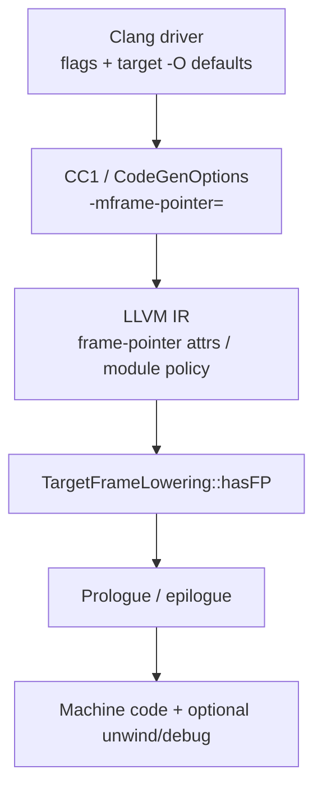

import Head from '@docusaurus/Head';
import FlagArticleShell from '@site/src/components/clang-flags/FlagArticleShell';
import PerfReport from '@site/src/components/clang-flags/PerfReport';
import AsmDiff from '@site/src/components/clang-flags/AsmDiff';
import SourceCode from '@site/src/components/clang-flags/SourceCode';
import KeyFacts from '@site/src/components/clang-flags/KeyFacts';
import Tabs from '@theme/Tabs';
import TabItem from '@theme/TabItem';

<Head>
  <title>-fomit-frame-pointer | Clang Flags Explorer</title>
  <meta name="description" content="Clang -fomit-frame-pointer sets frame-pointer policy via -mframe-pointer=; driver defaults are target- and version-dependent, and TargetFrameLowering may still require an FP." />
  <meta name="keywords" content="-fomit-frame-pointer, -fno-omit-frame-pointer, -mframe-pointer=, TargetFrameLowering, hasFP, frame pointer, Clang, LLVM, eh_frame" />
  <meta property="og:title" content="-fomit-frame-pointer | Clang Flags Explorer" />
  <meta property="og:description" content="What frame pointers are, how Clang’s driver policy maps to -mframe-pointer=, and how to verify asm on your triple." />
  <meta property="og:type" content="article" />
  <meta name="twitter:title" content="-fomit-frame-pointer | Clang Flags Explorer" />
  <meta name="twitter:description" content="What frame pointers are, how Clang’s driver policy maps to -mframe-pointer=, and how to verify asm on your triple." />
</Head>

{/* HAND_AUTHORED */}
<FlagArticleShell flagPath="-fomit-frame-pointer" summary="Ask Clang not to keep a dedicated frame-pointer register when the backend allows; defaults and asm are target- and version-dependent.">

<div className="text--center margin-bottom--md"><a className="button button--primary button--lg" href="https://docs.google.com/forms/d/e/1FAIpQLSebP1JfLFDp0ckTxOhODKPNVeI1e21rUqMJ0fbBwJoaa-i4Yw/viewform" target="_blank" rel="noopener noreferrer" aria-label="Subscribe to CompilerSutra Weekly Compiler Notes">✉ Subscribe to Weekly Compiler Notes</a><p className="margin-top--sm">Practical LLVM, Clang, and compiler-engineering notes delivered weekly.</p></div>

## At a glance

| Attribute | Details |
| :--- | :--- |
| **Architecture** | Target-dependent (`rbp`, `x29`, ARM FP, …) |
| **Category** | Backend / code generation (frame lowering) — **not** an IR optimization pass |
| **Compiler** | Clang (C/C++); related GCC flag; Flang has separate driver work (see history) |
| **Optimization Level** | Defaults depend on **target + Clang version**; do not treat one distro clang as universal |
| **Risk Level** | Low for correctness; high for FP-based profilers / some sanitizer stack traces |

**In one sentence:** a *frame pointer* is a dedicated register that points at a stable place in the current function’s stack frame. `-fomit-frame-pointer` asks the compiler to stop reserving that register when it is safe, freeing it for other uses and shrinking some prologues — without deleting the stack itself.

---

## Why frame pointers exist

On many ABIs the callee saves a “frame pointer” (x86-64: `%rbp`; AArch64: `x29`) and sets it to the current `%rsp`/`sp` at function entry. That gives:

1. A **stable base** for locals while `%rsp` moves (calls, `alloca`, VLAs).
2. A simple **linked list of frames** for some profilers and debuggers (`perf --call-graph fp`).
3. Clearer assembly for humans reading prologues.

When the compiler **omits** the FP, locals and CFA (Canonical Frame Address) are often described relative to the **stack pointer**, and unwind may rely on DWARF / `.eh_frame` instead of walking `%rbp` chains.

:::caution
Omitting the frame pointer is **not** “no stack frame,” **not** “no unwind info,” and **not** an LLVM PassBuilder optimization pass. Sanitizer instrumentation and runtimes are separate optional concerns.
:::

---

## What this flag actually does

On modern Clang (verified with Ubuntu **clang 18.1.3**):

1. **Driver policy** — `-fomit-frame-pointer` / `-fno-omit-frame-pointer` (and leaf variants) feed `getFramePointerKind()` and become cc1 **`-mframe-pointer=`** (`none` / `non-leaf` / `all` / `reserved`).
2. **CodeGen / IR** — keep policies commonly emit a `"frame-pointer"` function attribute (e.g. `"all"`). Omit often means that keep attribute is **absent** on 18.1.3 rather than always printing `"none"` — inspect your IR.
3. **Backend** — `TargetFrameLowering::hasFP()` (e.g. `X86FrameLowering::hasFP`) can still **require** an FP for VLAs, realignment, EH helpers, Win64 constraints, etc., even when policy is omit.
4. **Unwind / debug** — `.eh_frame`, exception tables, and `-g` debug sections are controlled by **other** flags; they are not the same knob as FP policy.

### Option map and precedence

| Flag | Role |
| :--- | :--- |
| `-fomit-frame-pointer` | Request omit policy |
| `-fno-omit-frame-pointer` | Request keep policy |
| `-mframe-pointer=all\|non-leaf\|reserved\|none` | Explicit cc1 / `CodeGenOptions::FramePointerKind` |
| `-momit-leaf-frame-pointer` | Prefer omitting FP in **leaf** functions when keep would otherwise apply |
| `-mno-omit-leaf-frame-pointer` | Prefer keeping FP in leaves |

**Precedence (simplified, from `getFramePointerKind` in llvmorg-18.1.3):** among `-fomit-frame-pointer` / `-fno-omit-frame-pointer`, the **last** wins. Leaf omit flags can turn an “all” keep into **`non-leaf`**. Target defaults also matter (AArch64 often defaults leaf-omit on). A frontend policy still does **not** guarantee identical assembly on every architecture.

---

## Defaults by optimization level (one verified host)

**Verified experimentally** — Ubuntu clang 18.1.3, triple `x86_64-pc-linux-gnu`, via `clang -###`:

| Last `-O` | Default `-mframe-pointer=` |
| :--- | :--- |
| (none) / `-O0` | `all` (keep) |
| `-O1` `-O2` `-O3` `-Os` `-Oz` `-Ofast` | `none` (omit) |

**Source (llvmorg-18.1.3):** `areOptimizationsEnabled()` is true iff the last `-O*` is not `-O0`; on Linux x86/x86_64, `useFramePointerForTargetByDefault()` returns the negation of that — so optimized builds default to omit.

:::important
This table is **not** a universal Clang rule. AArch64 Linux on the same clang often defaults to **`non-leaf`** even at `-O2`. Darwin often defaults to **keep**. Always check `clang -###` on your triple and version.
:::

---

## Clang version history

Research leads were checked against Options.td tags, LLVM/Clang release notes, and primary commits. Chronological; **only verified milestones**.

| Clang / LLVM version | Change | Practical impact | Evidence |
| :--- | :--- | :--- | :--- |
| **Present by LLVM/Clang 2.9** | `-fomit-frame-pointer` / `-fno-omit-frame-pointer` appear in `clang/include/clang/Driver/Options.td` | Driver-visible user flags exist in this release tag | [Options.td @ llvmorg-2.9.0](https://github.com/llvm/llvm-project/blob/llvmorg-2.9.0/clang/include/clang/Driver/Options.td) (**verified from source tag**). Earlier *introduction commit* vs first release was **not fully established** from available tags — do not treat 2.9 as “invented in 2.9,” only “present by 2.9.” |
| **LLVM 10 (2020)** | IR attrs `no-frame-pointer-elim` / `no-frame-pointer-elim-non-leaf` replaced by tri-state `"frame-pointer"` (`none`/`non-leaf`/`all`); Clang cc1 migrates to `-mframe-pointer=` | Uniform policy encoding across driver, IR, and codegen | [LLVM 10 ReleaseNotes](https://github.com/llvm/llvm-project/blob/llvmorg-10.0.0/llvm/docs/ReleaseNotes.rst); [D56353 / ff22ec3d70](https://reviews.llvm.org/D56353) (2019-07-20) |
| **Clang 11** | Defaults to `-fomit-frame-pointer` for **non-Android Linux arm/thumb** when optimizations are enabled (GCC-compatible) | ARM Linux optimized builds omit FP unless you pass `-fno-omit-frame-pointer` | [Clang 11 notes in llvmorg-11.0.0 `llvm/docs/ReleaseNotes.rst`](https://github.com/llvm/llvm-project/blob/llvmorg-11.0.0/llvm/docs/ReleaseNotes.rst) (ARM section) |
| **LLVM ~13 era (2021-04)** | Module flag `"frame-pointer"` for `-mframe-pointer={non-leaf,all}` (sanitizer/IR consumers) | Module-level policy visible to instrumentation | [2786e673c7](https://github.com/llvm/llvm-project/commit/2786e673c7) |
| **Clang 20** | ARM: leaf FP can be retained with `-fno-omit-frame-pointer`; use `-momit-leaf-frame-pointer` to drop leaf FP again | Clearer ARM leaf/non-leaf control | [Clang 20.1.0 ReleaseNotes](https://github.com/llvm/llvm-project/blob/llvmorg-20.1.0/clang/docs/ReleaseNotes.rst) |
| **Post–Clang 20 (2025-09)** | Darwin/macho ARM driver default toward `-mframe-pointer=non-leaf` | Apple ARM leaf default shift | [#154216 / f82023d72e](https://github.com/llvm/llvm-project/commit/f82023d72e) — landed after 20.1.0 tag; treat as **newer than Clang 20.1** unless your build includes it |
| **Flang (2025+)** | Flang driver gains `-mframe-pointer=reserved` handling and leaf omit flags | **Fortran driver**, separate from Clang C/C++ semantics | [flang #146937](https://github.com/llvm/llvm-project/commit/71ffa2a4d3), [flang leaf flags](https://github.com/llvm/llvm-project/commit/a67c8f208e) |

Documentation-only noise and build-system uses of `-fomit-frame-pointer` in ancient LLVM makefiles (e.g. 2003) are **not** Clang user-option introductions.

---

## Minimal realistic example

<SourceCode
  file="leaf.c"
  flag="-fomit-frame-pointer"
  language="c"
  code={`int leaf(int a, int b, int c, int d) {
  return (a + b) * (c - d);
}`}
/>

```bash
clang++ --version
clang -O2 -fno-omit-frame-pointer -S leaf.c -o keep.s
clang -O2 -fomit-frame-pointer     -S leaf.c -o omit.s
clang -### -O2 -fomit-frame-pointer -c leaf.c 2>&1 | tr '"' '\n' | rg mframe-pointer
```

**VLA can force an FP on x86 even with omit** (Ubuntu clang 18.1.3, `x86_64-pc-linux-gnu` — **verified experimentally**; do not generalize to all arches):

<SourceCode
  file="vla.c"
  flag="-fomit-frame-pointer"
  language="c"
  code={`int sum_vla(int n, int *base) {
  volatile int tmp[n];
  int s = 0;
  for (int i = 0; i < n; ++i) {
    tmp[i] = base[i];
    s += tmp[i];
  }
  return s;
}`}
/>

Variable-sized allocation moves `%rsp` by a runtime amount; `X86FrameLowering::hasFP` treats `hasVarSizedObjects()` as a reason to keep a dedicated FP so the frame has a stable base.

---

## Before vs. after assembly

**Verified experimentally:** Ubuntu clang 18.1.3, `x86_64-pc-linux-gnu` and `--target=aarch64-linux-gnu`.

<Tabs>
  <TabItem value="x86_64" label="x86_64 leaf (-O2)">
    <AsmDiff
      before={`leaf:  # -fno-omit-frame-pointer
	.cfi_startproc
	pushq	%rbp
	.cfi_def_cfa_offset 16
	.cfi_offset %rbp, -16
	movq	%rsp, %rbp
	.cfi_def_cfa_register %rbp
	leal	(%rdi,%rsi), %eax
	subl	%ecx, %edx
	imull	%edx, %eax
	popq	%rbp
	.cfi_def_cfa %rsp, 8
	retq`}
      after={`leaf:  # -fomit-frame-pointer
	.cfi_startproc
	leal	(%rdi,%rsi), %eax
	subl	%ecx, %edx
	imull	%edx, %eax
	retq`}
    />
  </TabItem>
  <TabItem value="x86_O0" label="x86_64 (-O0 omit still has stack)">
    <AsmDiff
      before={`# -O0 -fno-omit-frame-pointer → locals via %rbp
	pushq	%rbp
	movq	%rsp, %rbp
	movl	%edi, -4(%rbp)
	...
	popq	%rbp
	retq`}
      after={`# -O0 -fomit-frame-pointer → locals via %rsp
	movl	%edi, -4(%rsp)
	...
	retq`}
    />
  </TabItem>
  <TabItem value="a64" label="AArch64 leaf vs non-leaf (-O2)">
    <AsmDiff
      before={`# leaf: keep and omit identical (no x29)
leaf:
	sub	w8, w2, w3
	add	w9, w1, w0
	mul	w0, w8, w9
	ret`}
      after={`# non-leaf: keep establishes x29; omit does not
# keep:  stp x29,x30,[sp,#-32]!; mov x29,sp; bl g; ...
# omit:  str x30,[sp,#-32]!;           bl g; ...`}
    />
  </TabItem>
</Tabs>

**How to read the x86-64 keep prologue**

- `pushq %rbp` — save caller’s FP (callee-saved).
- `movq %rsp, %rbp` — this function’s dedicated FP; CFI switches CFA to `%rbp`.
- `popq %rbp` — restore; CFI returns CFA accounting to `%rsp`.
- Omit drops that pair; `.cfi_startproc` can remain. At `-O0`, omit still stores locals at `-N(%rsp)` — **stack remains**.

**Why AArch64 can look “unchanged” on a leaf:** driver policy is often `-mframe-pointer=non-leaf`, so a simple leaf never needed `x29` even under “keep.” Compare a **non-leaf** before concluding the flag does nothing.

IR on the x86_64 leaf (`-O2`): keep shows `"frame-pointer"="all"`; omit drops it (**verified experimentally**).

---

## Frame pointers vs unwind vs debug

| Concept | What it is | Typical control |
| :--- | :--- | :--- |
| Dedicated FP register | `%rbp` / `x29` reserved as frame base | `-f(no-)omit-frame-pointer`, `-mframe-pointer=` |
| Stack frame | Space for locals/spills/alignment | Backend; exists with or without FP |
| Asm CFI directives | `.cfi_*` in `.s` describing CFA | Emitter alongside prologues |
| `.eh_frame` | Unwind tables in the object | Often `-fasynchronous-unwind-tables` / `-funwind-tables=` |
| Exception unwind | Personality / LSDA / landing pads | EH / `-fexceptions` world |
| Debug info | `.debug_*` | `-g` |

**Verified sample** (`x86_64-pc-linux-gnu`, `-O2 -fomit-frame-pointer` leaf): object still had `.eh_frame`; `llvm-readobj -u` showed `DW_CFA_def_cfa: reg7 +8` (`rsp`-based). `-fno-asynchronous-unwind-tables` removed `.eh_frame` while FP policy stayed `none`. So: **omit FP ≠ disable unwinding**, and **CFI is not “required by every ABI”** — emission depends on target and flags.

---

## Why use it / when not to

### Prefer omit (after you measure)

- Linux/ELF production builds that already ship reliable DWARF/`eh_frame` unwind.
- Register-pressure-sensitive code **on a workload that actually stresses it**.

### Prefer keep (`-fno-omit-frame-pointer`)

- FP-based sampling (`perf record -g --call-graph fp`).
- Sanitizer / crash stacks that you have measured as clearer with FP (sanitizers are **not** part of this flag’s compile pipeline; they are a separate product concern).
- Platforms/defaults that expect FP (many Darwin configurations).

---

## Performance impact

**Verified experimentally** with [CompilerSutraPerf](/docs/project/compilersutra-perf/) (`csperf` 0.3.0):

| Item | Value |
| :--- | :--- |
| Workload | `docs/tools/clang-flags-workloads/pic_bench.c` — 50M calls to `noinline` `bump()` on a `volatile` global (PIC/global loop; **not** a register-pressure microbench) |
| Machine | AMD Ryzen 7 9700X, `x86_64-pc-linux-gnu`, affinity 0 |
| Compiler | Ubuntu clang 18.1.3 |
| Setup | 1 warmup, 5 trials, `--no-perf` |
| Keep (ms) | 40.521, 41.508, 41.473, 41.428, 40.506 → mean **41.087** |
| Omit (ms) | 40.534, 41.628, 40.625, 41.286, 41.073 → mean **41.029** |
| Leaf `.text` size | keep **70** B vs omit **57** B (`llvm-size`) |

```bash
csperf run --input docs/tools/clang-flags-workloads/pic_bench.c \
  --backend cpu --cpu-affinity 0 --warmup-runs 1 --repeat-runs 5 --no-perf \
  --compiler-flag=-O2 --compiler-flag=-fno-omit-frame-pointer

csperf run --input docs/tools/clang-flags-workloads/pic_bench.c \
  --backend cpu --cpu-affinity 0 --warmup-runs 1 --repeat-runs 5 --no-perf \
  --compiler-flag=-O2 --compiler-flag=-fomit-frame-pointer
```

<PerfReport
  beforeTitle="Clang -O2 -fno-omit-frame-pointer"
  afterTitle="Clang -O2 -fomit-frame-pointer"
  without={[40.521, 41.508, 41.473, 41.428, 40.506]}
  with={[40.534, 41.628, 40.625, 41.286, 41.073]}
  note="Means 41.087 vs 41.029 ms (~0.14%). Within run-to-run noise — not a demonstrated speedup. Do not conclude omit-FP is “faster” from this benchmark."
/>

**What you can conclude:** prologue size can shrink. **What you cannot:** a general runtime win from omit-FP on modern x86_64 from this workload alone.

---

## Compatibility (clang 18.1.3 snapshot)

Distinguish **driver policy** (`clang -###`) from **final asm** (`clang -S`).

| Target | `-O0` driver | `-O2` driver | Asm notes | Status |
| :--- | :--- | :--- | :--- | :--- |
| `x86_64-pc-linux-gnu` | `all` | `none` | Leaf keep has FP prologue; omit drops it. Non-leaf omit may still `push %rbp` as a **GPR** spill. | **Verified experimentally** |
| `aarch64-linux-gnu` | `non-leaf` | `non-leaf` | Leaf keep≈omit; non-leaf keep uses `x29`. | **Verified experimentally** (`--target=`) |
| `x86_64-apple-darwin` | `all` | `all` | — | Driver **verified** via `--target`; **asm not verified** (no Darwin SDK) |
| `x86_64-pc-windows-msvc` | `none` | `none` | SEH / Win64 | Driver **verified** via `--target`; **asm not verified** |
| Linux arm/thumb | version-dependent (Clang 11+ optimized default omit for non-Android) | — | — | **Documented** in Clang 11 notes; not re-measured on this host |

---

## Adjacent options

| Option | Affects | Notes |
| :--- | :--- | :--- |
| `-fomit-frame-pointer` | FP **policy** | → `-mframe-pointer=none` (typical) |
| `-fno-omit-frame-pointer` | FP **policy** | → `all` or `non-leaf` depending on leaf defaults |
| `-momit-leaf-frame-pointer` / `-mno-omit-leaf-frame-pointer` | FP **policy** (leaves) | AArch64 often defaults leaf-omit on |
| `-mframe-pointer=` | FP **policy** (cc1) | `all` / `non-leaf` / `reserved` / `none` |
| `-g` | **Debug** | Does not flip `-mframe-pointer=` at `-O2` on this host (**verified**) |
| `-fasynchronous-unwind-tables` | **Unwind tables** | Independent of FP; can remove `.eh_frame` with `-fno-…` |

---

## How it works inside Clang



| Stage | Detail |
| :--- | :--- |
| Options.td | [`fomit_frame_pointer`](https://github.com/llvm/llvm-project/blob/llvmorg-18.1.3/clang/include/clang/Driver/Options.td), [`mframe_pointer_EQ`](https://github.com/llvm/llvm-project/blob/llvmorg-18.1.3/clang/include/clang/Driver/Options.td) |
| Driver | [`getFramePointerKind`](https://github.com/llvm/llvm-project/blob/llvmorg-18.1.3/clang/lib/Driver/ToolChains/CommonArgs.cpp) / [`useFramePointerForTargetByDefault`](https://github.com/llvm/llvm-project/blob/llvmorg-18.1.3/clang/lib/Driver/ToolChains/CommonArgs.cpp) / [`areOptimizationsEnabled`](https://github.com/llvm/llvm-project/blob/llvmorg-18.1.3/clang/lib/Driver/ToolChains/CommonArgs.cpp) |
| CodeGenOptions | `FramePointer` / `FramePointerKind` |
| Backend | [`X86FrameLowering::hasFP`](https://github.com/llvm/llvm-project/blob/llvmorg-18.1.3/llvm/lib/Target/X86/X86FrameLowering.cpp#L96) |

---

## Related LLVM Optimizations & Backend Mechanisms

**Category:** Backend / code generation. **No direct IR optimization pass.**

| Mechanism | Stage | Relationship | Effect |
| :--- | :--- | :--- | :--- |
| Opt-level / target defaults | Driver | Directly controlled (default) | Target-specific keep vs omit |
| `-f(no-)omit-frame-pointer` | Driver | Directly controlled | Selects `-mframe-pointer=` |
| `"frame-pointer"` IR attr | LLVM IR | Directly controlled / configured | Policy into backend |
| `TargetFrameLowering::hasFP` | Machine backend | Backend mechanism | May force FP (VLA, EH, …) |
| Regalloc / prologue | Machine backend | Indirectly affected | May free FP register or shrink prologue |
| `.eh_frame` / `-g` | Object emission | Related mechanism | Orthogonal knobs |

### Practical verification workflow

```bash
clang++ --version
# 1) Driver policy
clang -### -O0 -c leaf.c 2>&1 | tr '"' '\n' | rg mframe-pointer
clang -### -O2 -c leaf.c 2>&1 | tr '"' '\n' | rg mframe-pointer
clang -### -O2 -fno-omit-frame-pointer -c leaf.c 2>&1 | tr '"' '\n' | rg mframe-pointer

# 2) IR
clang -O2 -fno-omit-frame-pointer -S -emit-llvm leaf.c -o keep.ll
clang -O2 -fomit-frame-pointer     -S -emit-llvm leaf.c -o omit.ll
rg 'frame-pointer' keep.ll omit.ll

# 3) Assembly
clang -O2 -fno-omit-frame-pointer -S leaf.c -o keep.s
clang -O2 -fomit-frame-pointer     -S leaf.c -o omit.s

# 4) Object / unwind
clang -O2 -fomit-frame-pointer -c leaf.c -o omit.o
llvm-objdump -d omit.o | head
readelf -S omit.o | rg 'eh_frame|debug'
llvm-readobj -u omit.o | head

# 5) Backend override example (x86 VLA)
clang -O1 -fomit-frame-pointer -S vla.c -o vla-omit.s   # expect FP prologue on x86_64 18.1.3
```

Inspect: `-mframe-pointer=` in `-###`, `"frame-pointer"` in IR, `push %rbp`/`mov %rsp,%rbp` or AArch64 `x29` in asm, and whether `.eh_frame` exists independently.

### Source investigation

- [Options.td (llvmorg-18.1.3)](https://github.com/llvm/llvm-project/blob/llvmorg-18.1.3/clang/include/clang/Driver/Options.td)
- [CommonArgs.cpp frame-pointer policy](https://github.com/llvm/llvm-project/blob/llvmorg-18.1.3/clang/lib/Driver/ToolChains/CommonArgs.cpp)
- [X86FrameLowering::hasFP](https://github.com/llvm/llvm-project/blob/llvmorg-18.1.3/llvm/lib/Target/X86/X86FrameLowering.cpp#L96)
- Tri-state migration: [D56353](https://reviews.llvm.org/D56353)

**Still unresolved / unverified here:** Darwin and Windows final asm; full AArch64 `hasFP` source walkthrough; exact pre-2.9 introduction commit/first release; runtime wins on a true register-pressure benchmark.

---

## Key facts

<KeyFacts
  items={[
    { label: 'Argument form', value: 'Flag (no argument)', icon: 'check' },
    { label: 'Accepted by', value: 'Clang driver → cc1 -mframe-pointer=', icon: 'check' },
    { label: 'Stage', value: 'Driver / CodeGen / TargetFrameLowering', icon: 'check' },
    { label: 'Negated by', value: '-fno-omit-frame-pointer', icon: 'check' },
    { label: 'Defined in', value: 'clang/include/clang/Driver/Options.td', icon: 'info' },
    { label: 'IR opt pass?', value: 'No — frame-pointer policy only', icon: 'info' },
  ]}
/>

</FlagArticleShell>
