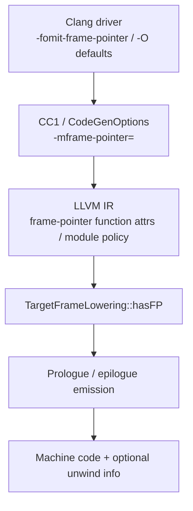

import Head from '@docusaurus/Head';
import FlagArticleShell from '@site/src/components/clang-flags/FlagArticleShell';
import PerfReport from '@site/src/components/clang-flags/PerfReport';
import AsmDiff from '@site/src/components/clang-flags/AsmDiff';
import SourceCode from '@site/src/components/clang-flags/SourceCode';
import KeyFacts from '@site/src/components/clang-flags/KeyFacts';
import Tabs from '@theme/Tabs';
import TabItem from '@theme/TabItem';

<Head>
  <title>-fomit-frame-pointer | Clang Flags Explorer</title>
  <meta name="description" content="Clang -fomit-frame-pointer sets backend frame-pointer policy via -mframe-pointer=; it is code generation / TargetFrameLowering, not an LLVM IR optimization pass." />
  <meta name="keywords" content="-fomit-frame-pointer, -fno-omit-frame-pointer, -mframe-pointer=, TargetFrameLowering, hasFP, frame pointer, Clang, LLVM" />
  <meta property="og:title" content="-fomit-frame-pointer | Clang Flags Explorer" />
  <meta property="og:description" content="Backend frame-pointer policy: driver -mframe-pointer=, IR attributes, and TargetFrameLowering::hasFP — not an IR optimization pass." />
  <meta property="og:type" content="article" />
  <meta name="twitter:title" content="-fomit-frame-pointer | Clang Flags Explorer" />
  <meta name="twitter:description" content="Backend frame-pointer policy: driver -mframe-pointer=, IR attributes, and TargetFrameLowering::hasFP — not an IR optimization pass." />
</Head>

{/* HAND_AUTHORED */}
<FlagArticleShell flagPath="-fomit-frame-pointer" summary="Backend frame-pointer policy forwarded as -mframe-pointer=none; TargetFrameLowering::hasFP may still force an FP for VLAs and other constraints.">

<div className="text--center margin-bottom--md"><a className="button button--primary button--lg" href="https://docs.google.com/forms/d/e/1FAIpQLSebP1JfLFDp0ckTxOhODKPNVeI1e21rUqMJ0fbBwJoaa-i4Yw/viewform" target="_blank" rel="noopener noreferrer" aria-label="Subscribe to CompilerSutra Weekly Compiler Notes">✉ Subscribe to Weekly Compiler Notes</a><p className="margin-top--sm">Practical LLVM, Clang, and compiler-engineering notes delivered weekly.</p></div>

## At a glance

| Attribute | Details |
| :--- | :--- |
| **Architecture** | Target-dependent defaults and FP register (`rbp` / `x29` / …) |
| **Category** | Backend / code generation (frame lowering) |
| **Compiler** | Clang, GCC (related); Clang driver maps to `-mframe-pointer=` |
| **Optimization Level** | On many Linux/ELF targets, `-O1` and higher omit by default; `-O0` keeps |
| **Risk Level** | Low for correctness; high for FP-based profilers / some sanitizer workflows |

**Summary**: `-fomit-frame-pointer` asks Clang not to keep a dedicated frame-pointer register when the target’s `hasFP()` logic allows. It is **not** an LLVM IR optimization pass, and it does **not** mean “no stack frame”.

---

## What this flag actually does

1. **Driver policy**: Clang translates the flag into the cc1 option `-mframe-pointer=` (`none` when omitting, `all` when forcing keep with `-fno-omit-frame-pointer` on Ubuntu clang 18.1.3).
2. **CodeGen / IR**: Keep policies commonly appear as a function attribute `"frame-pointer"="all"` (and module metadata). Omit often means that keep attribute is absent rather than always printing `"frame-pointer"="none"` — inspect IR for your Clang version.
3. **Backend decision**: `TargetFrameLowering::hasFP()` (target override, e.g. `X86FrameLowering::hasFP`) decides whether a dedicated FP is required. Variable-sized objects, realignment, EH, and other conditions can force an FP **even when** omit is requested.
4. **Unwind vs FP**: A dedicated frame pointer is separate from DWARF CFI directives in assembly, the `.eh_frame` section, exception-unwind tables, and `-g` debug info. Omitting the FP register does not by itself disable unwind or debug emission.

:::caution
Do not call `-fomit-frame-pointer` an LLVM optimization pass. Do not claim it always frees a general-purpose register, and do not equate it with stack-frame elimination. Sanitizer instrumentation and runtime linking are separate optional compilation concerns — not stages of this flag’s pipeline.
:::

### Defaults and precedence — which `-O` enables omit?

**No LLVM IR optimization pass enables this flag.** On Linux `x86_64` (this host), the Clang **driver** decides the default from the last `-O` group argument via `areOptimizationsEnabled()` → `useFramePointerForTargetByDefault()` → `getFramePointerKind()`.

`areOptimizationsEnabled` (llvmorg-18.1.3 `CommonArgs.cpp`) is:

- `false` when there is no `-O*` or the last one is `-O0` → **keep** FP (`-mframe-pointer=all`)
- `true` when the last `-O*` is **anything other than `-O0`** → **omit** FP (`-mframe-pointer=none`)

Verified with Ubuntu clang 18.1.3, `clang -### -c t.c`:

| Last `-O` | Default `-mframe-pointer=` | Effect |
| :--- | :--- | :--- |
| (none) / `-O0` | `all` | Keep dedicated FP |
| `-O1` | `none` | Omit (default enable of omit policy) |
| `-O2` | `none` | Omit |
| `-O3` | `none` | Omit |
| `-Os` | `none` | Omit |
| `-Oz` | `none` | Omit |
| `-Ofast` | `none` | Omit |

So **every non-`-O0` optimization level** turns on the omit-frame-pointer **policy by default** on this Linux x86/x86_64 target — not InstCombine, not a vectorizer, not a named PassBuilder pass.

Still subject to:

- Explicit `-fomit-frame-pointer` / `-fno-omit-frame-pointer` (last wins among that pair)
- Leaf overrides `-m[no-]omit-leaf-frame-pointer` (can yield `non-leaf` instead of `all`)
- Target exceptions in `useFramePointerForTargetByDefault` (Darwin often keeps; Android AArch64/ARM keeps; wasm/xcore never want FP; …)
- Backend `hasFP()` still forcing an FP for VLAs / realign / EH even when policy is `none`

---

## Minimal realistic example

<SourceCode
  file="leaf.c"
  flag="-fomit-frame-pointer"
  language="c"
  code={`int compute_sum(int a, int b, int c, int d) {
  int temp = a + b;
  return temp * (c - d);
}`}
/>

```bash
clang -O1 -fno-omit-frame-pointer -S leaf.c -o keep.s
clang -O1 -fomit-frame-pointer     -S leaf.c -o omit.s
clang -### -O1 -fomit-frame-pointer -c leaf.c 2>&1 | tr ' ' '\n' | rg mframe-pointer
# → -mframe-pointer=none
```

Counter-example (stack without a dedicated FP at `-O0`):

```bash
clang -O0 -fomit-frame-pointer -S leaf.c -o omit-O0.s
# Locals are still spilled relative to %rsp; only the rbp chain is gone.
```

Forced FP despite omit (volatile VLA → `hasVarSizedObjects` on x86):

<SourceCode
  file="vla.c"
  flag="-fomit-frame-pointer"
  language="c"
  code={`int sum_vla(int n, int *base) {
  volatile int tmp[n];
  int s = 0;
  for (int i = 0; i < n; ++i) {
    tmp[i] = base[i];
    s += tmp[i];
  }
  return s;
}`}
/>

```bash
clang -O1 -fomit-frame-pointer -S vla.c -o vla-omit.s
# x86_64 clang 18.1.3 still emits pushq %rbp / movq %rsp, %rbp.
```

:::note
**Why a VLA can force an FP (x86, verified experimentally):** a variable-sized allocation moves `%rsp` by a runtime amount. A stable base (historically `%rbp`) makes addressing of fixed locals and restoring the stack on exit straightforward. `X86FrameLowering::hasFP` treats `hasVarSizedObjects()` as a reason to keep a dedicated FP even when the driver policy is omit. **This observation is specific to the tested compiler/target** (Ubuntu clang 18.1.3, `x86_64-pc-linux-gnu`). Do not assume every architecture uses the same prologue shape for VLAs.
:::

---

## Before vs. after assembly

**Verified experimentally:** Ubuntu clang 18.1.3, host triple `x86_64-pc-linux-gnu`.

<Tabs>
  <TabItem value="x86_64" label="x86_64 leaf (-O2)">
    <AsmDiff
      before={`leaf:  # -fno-omit-frame-pointer
	.cfi_startproc
	pushq	%rbp
	.cfi_def_cfa_offset 16
	.cfi_offset %rbp, -16
	movq	%rsp, %rbp
	.cfi_def_cfa_register %rbp
	leal	(%rdi,%rsi), %eax
	subl	%ecx, %edx
	imull	%edx, %eax
	popq	%rbp
	.cfi_def_cfa %rsp, 8
	retq`}
      after={`leaf:  # -fomit-frame-pointer
	.cfi_startproc
	leal	(%rdi,%rsi), %eax
	subl	%ecx, %edx
	imull	%edx, %eax
	retq`}
    />
  </TabItem>
  <TabItem value="x86_O0" label="x86_64 leaf (-O0 omit still has stack)">
    <AsmDiff
      before={`# -O0 -fno-omit-frame-pointer
compute_sum:
	pushq	%rbp
	movq	%rsp, %rbp
	movl	%edi, -4(%rbp)
	movl	%esi, -8(%rbp)
	# ... arithmetic via -N(%rbp) ...
	popq	%rbp
	retq`}
      after={`# -O0 -fomit-frame-pointer
compute_sum:
	movl	%edi, -4(%rsp)
	movl	%esi, -8(%rsp)
	# ... arithmetic via -N(%rsp) ...
	retq`}
    />
  </TabItem>
  <TabItem value="a64" label="AArch64 leaf vs non-leaf (-O2)">
    <AsmDiff
      before={`# leaf: -fno-omit and -fomit are identical (no x29)
leaf:
	sub	w8, w2, w3
	add	w9, w1, w0
	mul	w0, w8, w9
	ret`}
      after={`# non-leaf -fno-omit keeps x29; -fomit drops it
# -fno-omit-frame-pointer:
	stp	x29, x30, [sp, #-32]!
	mov	x29, sp
	bl	g
	...
# -fomit-frame-pointer:
	str	x30, [sp, #-32]!
	# no mov x29, sp
	bl	g
	...`}
    />
  </TabItem>
</Tabs>

**x86-64 leaf annotations (keep side):**

- `pushq %rbp` — save the caller’s frame pointer (callee-saved).
- `movq %rsp, %rbp` — establish `%rbp` as this frame’s dedicated FP; CFA moves to `%rbp` via `.cfi_def_cfa_register %rbp`.
- `popq %rbp` — restore caller FP; `.cfi_def_cfa %rsp, 8` returns CFA accounting to the stack pointer.
- Omit side drops that prologue/epilogue; `.cfi_startproc` / `.cfi_endproc` can remain. Locals may still use `%rsp`-relative storage (`-O0` tab) — **omit FP ≠ eliminate stack**.

**AArch64 note (verified experimentally with `--target=aarch64-linux-gnu`):** for this leaf at `-O2`, keep and omit asm are identical (no `x29` setup). For a non-leaf that calls `g`, keep emits `stp x29, x30` + `mov x29, sp`; omit keeps `x30` spill without establishing `x29` as FP. Driver policy on AArch64 often defaults to `-mframe-pointer=non-leaf` (see compatibility table) — a requested keep policy does **not** guarantee an FP in every function.

IR attributes for the x86_64 leaf (`-O2`): keep has `"frame-pointer"="all"`; omit drops that attribute (**verified experimentally**).

---

## Why use it / when not to use it

### When to use

- Production Linux/ELF builds where DWARF/`eh_frame` unwinding is acceptable and you want smaller prologues.
- Workloads that are register-pressure sensitive **after you measure** (especially denser 32-bit ABIs historically).

### When NOT to use

- FP-based sampling (`perf record -g --call-graph fp`, many eBPF stack walkers).
- Sanitizer / crash-reporting workflows that prefer fast FP stacks (`-fno-omit-frame-pointer`).
- Darwin defaults / platform profilers that expect retained frame pointers.

---

## Performance impact

Qualitative: omit can shrink prologues and may free a register for allocation when `hasFP()` is false. Runtime deltas are often noise on modern x86_64; measure on a workload that actually stresses register pressure or call overhead.

**Verified experimentally** with [CompilerSutraPerf](/docs/project/compilersutra-perf/) ([PyPI](https://pypi.org/project/compilersutra-perf/)) `csperf` 0.3.0:

| Item | Value |
| :--- | :--- |
| Workload | `docs/tools/clang-flags-workloads/pic_bench.c` — 50M iterations calling a `noinline` `bump()` that mutates a `volatile` global (PIC/global-heavy loop; **not** a register-pressure microbench) |
| Machine | AMD Ryzen 7 9700X, `x86_64-pc-linux-gnu`, CPU affinity 0 |
| Compiler | Ubuntu clang 18.1.3 |
| Setup | 1 warmup, 5 measured trials, `--no-perf` |
| Keep trials (ms) | 40.521, 41.508, 41.473, 41.428, 40.506 (mean **41.087**) |
| Omit trials (ms) | 40.534, 41.628, 40.625, 41.286, 41.073 (mean **41.029**) |
| Code size (leaf `.o` text) | keep **70** B vs omit **57** B (`llvm-size` on `-O2` leaf object) |

```bash
csperf run --input docs/tools/clang-flags-workloads/pic_bench.c \
  --backend cpu --cpu-affinity 0 --warmup-runs 1 --repeat-runs 5 --no-perf \
  --compiler-flag=-O2 --compiler-flag=-fno-omit-frame-pointer

csperf run --input docs/tools/clang-flags-workloads/pic_bench.c \
  --backend cpu --cpu-affinity 0 --warmup-runs 1 --repeat-runs 5 --no-perf \
  --compiler-flag=-O2 --compiler-flag=-fomit-frame-pointer
```

<PerfReport
  beforeTitle="Clang -O2 -fno-omit-frame-pointer"
  afterTitle="Clang -O2 -fomit-frame-pointer"
  without={[40.521, 41.508, 41.473, 41.428, 40.506]}
  with={[40.534, 41.628, 40.625, 41.286, 41.073]}
  note="Means 41.087 ms (keep) vs 41.029 ms (omit) on pic_bench.c. The ~0.14% delta is within run-to-run noise and is not a demonstrated performance win. This workload does not meaningfully exercise register pressure from FP reservation."
/>

---

## Compatibility table

Compiler for all rows: **Ubuntu clang 18.1.3**. Distinguish **driver policy** (`clang -###` → `-mframe-pointer=`) from **final asm** (`clang -S`).

| Target | `-O0` driver | `-O2` driver | Explicit omit / keep | Leaf / non-leaf asm | Status |
| :--- | :--- | :--- | :--- | :--- | :--- |
| `x86_64-pc-linux-gnu` | `all` | `none` | `none` / `all` | Leaf: keep has `push %rbp`+`mov %rsp,%rbp`; omit drops it. Non-leaf omit may still `push %rbp` as a **GPR** spill without FP setup. | **Verified experimentally** (host) |
| `aarch64-linux-gnu` | `non-leaf` | `non-leaf` | `none` / `non-leaf` | Leaf keep≈omit (no `x29`). Non-leaf keep establishes `x29`; omit does not. | **Verified experimentally** (`--target=`) |
| `x86_64-apple-darwin` | `all` | `all` | (driver reachable via `--target`) | Final Darwin object/asm | Driver policy **verified** via `--target`; **asm not yet verified** (no Darwin SDK here) |
| `x86_64-pc-windows-msvc` | `none` | `none` | (driver reachable via `--target`) | SEH / Win64 prologue interaction | Driver policy **verified** via `--target`; **asm / SEH not yet verified** |

Source for Linux x86 omit-on-`-O*≠O0` defaults: [`useFramePointerForTargetByDefault`](https://github.com/llvm/llvm-project/blob/llvmorg-18.1.3/clang/lib/Driver/ToolChains/CommonArgs.cpp#L75) + [`areOptimizationsEnabled`](https://github.com/llvm/llvm-project/blob/llvmorg-18.1.3/clang/lib/Driver/ToolChains/CommonArgs.cpp#L1630). AArch64 default leaf omission comes from `getFramePointerKind`’s default for `-momit-leaf-frame-pointer` on AArch64 (**verified in source**).

---

## Usage example

```bash
clang++ -O2 -fomit-frame-pointer -c engine.cpp -o engine.o
clang++ -O3 -fno-omit-frame-pointer -g bench.cpp -o bench

# Inspect driver → cc1 policy
clang -### -O2 -fomit-frame-pointer -c engine.cpp 2>&1 | tr ' ' '\n' | rg mframe-pointer
```

---

## Adjacent options

| Option | Affects | Notes (clang 18.1.3, Linux x86_64 unless stated) |
| :--- | :--- | :--- |
| `-fomit-frame-pointer` | Frame-pointer **policy** | → `-mframe-pointer=none` |
| `-fno-omit-frame-pointer` | Frame-pointer **policy** | → `-mframe-pointer=all` on this host; AArch64 often `non-leaf` when leaf-omit default applies |
| `-momit-leaf-frame-pointer` | Frame-pointer **policy** (leaves) | Can yield `non-leaf` keep kind; default-on for AArch64 in `getFramePointerKind` |
| `-mno-omit-leaf-frame-pointer` | Frame-pointer **policy** (leaves) | Prefer FP in leaves when keep policy is active |
| `-mframe-pointer=` | Frame-pointer **policy** (cc1) | `all` / `non-leaf` / `reserved` / `none` → `CodeGenOptions::FramePointer` |
| `-g` | **Debug info** | Emits `.debug_*`; does **not** by itself flip `-mframe-pointer=` on this host at `-O2` (**verified experimentally**) |
| `-fasynchronous-unwind-tables` / `-fno-asynchronous-unwind-tables` | **Unwind tables** | Controls `.eh_frame` emission (`-funwind-tables=…`); independent of FP policy. `-fno-asynchronous-unwind-tables` removed `.eh_frame` on a leaf `-O2` object here while FP policy stayed `none` |

Do not assume identical defaults across Darwin, Android, or Windows — see the compatibility table.

---

## How it works inside Clang

| Pipeline Stage | Implementation Detail |
| :--- | :--- |
| **Options.td** | [`fomit_frame_pointer`](https://github.com/llvm/llvm-project/blob/59e601a3d5e7669fdf809b9c6494e6f877ea5cd8/clang/include/clang/Driver/Options.td#L3719); cc1 [`mframe_pointer_EQ`](https://github.com/llvm/llvm-project/blob/59e601a3d5e7669fdf809b9c6494e6f877ea5cd8/clang/include/clang/Driver/Options.td#L8451) marshals `CodeGenOptions::FramePointer` |
| **Driver** | `getFramePointerKind` → `-mframe-pointer=`; default omit when `areOptimizationsEnabled` (any `-O` except `-O0`) on Linux x86_64. Explicit `-fomit-frame-pointer` / `-fno-omit-frame-pointer` override. |
| **CodeGenOptions** | `FramePointer` / `FramePointerKind` marshalled from `-mframe-pointer=` ([`mframe_pointer_EQ`](https://github.com/llvm/llvm-project/blob/llvmorg-18.1.3/clang/include/clang/Driver/Options.td) → CodeGenOpts) |
| **LLVM IR** | Keep → `"frame-pointer"="all"` (typical); omit → attribute often absent on 18.1.3 |
| **Target frame lowering** | `X86FrameLowering::hasFP` returns true if frame-pointer elimination is disabled **or** var-sized objects / realignment / EH / … ([llvmorg-18.1.3](https://github.com/llvm/llvm-project/blob/llvmorg-18.1.3/llvm/lib/Target/X86/X86FrameLowering.cpp#L96)) |
| **Object emission** | May emit `.eh_frame` / debug sections depending on unwind and `-g` flags — orthogonal to FP policy |



Sanitizer instrumentation and runtime libraries are **not** stages of this pipeline; enable them separately (for example `-fsanitize=address`) when needed.

---

## Related LLVM Optimizations & Backend Mechanisms

**Flag category:** Backend / code generation. **No direct LLVM IR optimization pass** (`NO_DIRECT_IR_OPTIMIZATION_PASS`).

| Mechanism | Stage | Relationship | Effect |
| :--- | :--- | :--- | :--- |
| `areOptimizationsEnabled` / `useFramePointerForTargetByDefault` | Clang Driver | Directly controlled (default) | Any non-`-O0` opt level → default omit on Linux x86_64; `-O0`/no `-O` → keep |
| Frame-pointer driver flags | Clang Driver | Directly controlled | `-fomit-frame-pointer` / `-fno-omit-frame-pointer` select `-mframe-pointer=` |
| `CodeGenOptions::FramePointer` / `-mframe-pointer=` | cc1 / CodeGen | Directly controlled | Enum: `All`, `NonLeaf`, `Reserved`, `None` |
| `"frame-pointer"` function attribute | LLVM IR | Directly controlled / configured | Communicates keep policy to the backend |
| `TargetFrameLowering::hasFP()` / `X86FrameLowering::hasFP` | Machine backend | Backend mechanism | Final FP requirement (VLA, realign, EH, …) |
| Register allocation | Machine backend | Indirectly affected | FP register not reserved as FP when `hasFP()` is false — not a universal extra GPR |
| Prologue / epilogue emission | Machine backend | Indirectly affected | May omit `push %rbp` / `mov %rsp,%rbp` / `pop %rbp` |
| Unwind / CFI / `.eh_frame` | Object emission | Related mechanism | Often emitted for async unwind on Linux ELF; not the same knob as FP policy |
| Debug info (`-g`) | Object emission | Related mechanism | `.debug_*` sections; independent of `-mframe-pointer=` on the host tests above |

### Unwind vs frame pointer (verified sample)

On `x86_64-pc-linux-gnu`, `-O2 -fomit-frame-pointer` leaf object still contained `.eh_frame`. `llvm-readobj -u` showed a CIE with `DW_CFA_def_cfa: reg7 +8` (`rsp`-based CFA) — no dedicated FP register in the unwind program:

```text
.eh_frame section:
  CIE augmentation: zR
  Program:
    DW_CFA_def_cfa: reg7 +8
    DW_CFA_offset: reg16 -8
```

```bash
clang -O2 -fomit-frame-pointer -c leaf.c -o omit.o
readelf -S omit.o | rg eh_frame
llvm-readobj -u omit.o | head
clang -O2 -fomit-frame-pointer -fno-asynchronous-unwind-tables -c leaf.c -o noeh.o
readelf -S noeh.o | rg eh_frame || echo 'no .eh_frame'
```

### How to verify

```bash
clang --version   # Ubuntu clang 18.1.3 used for this article

# Which -O enables omit by default? (Linux x86_64)
for O in '' -O0 -O1 -O2 -O3 -Os -Oz -Ofast; do
  clang -### $O -c leaf.c 2>&1 | tr '"' '\n' | rg 'mframe-pointer='
done
# Explicit overrides
clang -### -O2 -fomit-frame-pointer -c leaf.c 2>&1 | tr '"' '\n' | rg 'mframe-pointer='
clang -### -O2 -fno-omit-frame-pointer -c leaf.c 2>&1 | tr '"' '\n' | rg 'mframe-pointer='

# IR
clang -O1 -fno-omit-frame-pointer -S -emit-llvm leaf.c -o keep.ll
clang -O1 -fomit-frame-pointer     -S -emit-llvm leaf.c -o omit.ll
rg 'frame-pointer' keep.ll omit.ll

# Asm
clang -O1 -fno-omit-frame-pointer -S leaf.c -o keep.s
clang -O1 -fomit-frame-pointer     -S leaf.c -o omit.s
clang -O0 -fomit-frame-pointer     -S leaf.c -o omit-O0.s   # stack via %rsp
clang -O1 -fomit-frame-pointer     -S vla.c  -o vla-omit.s  # FP forced

# Do NOT use: opt -passes=...  — this flag is not an IR opt-pipeline control.
```

### Source investigation

- [Options.td `fomit_frame_pointer`](https://github.com/llvm/llvm-project/blob/59e601a3d5e7669fdf809b9c6494e6f877ea5cd8/clang/include/clang/Driver/Options.td#L3719) (explorer inventory commit `59e601a3…`)
- [Options.td `mframe_pointer_EQ`](https://github.com/llvm/llvm-project/blob/59e601a3d5e7669fdf809b9c6494e6f877ea5cd8/clang/include/clang/Driver/Options.td#L8451)
- Opt-level default: [`areOptimizationsEnabled`](https://github.com/llvm/llvm-project/blob/llvmorg-18.1.3/clang/lib/Driver/ToolChains/CommonArgs.cpp#L1630) (true iff last `-O*` is not `-O0`) and [`useFramePointerForTargetByDefault`](https://github.com/llvm/llvm-project/blob/llvmorg-18.1.3/clang/lib/Driver/ToolChains/CommonArgs.cpp#L75) / [`getFramePointerKind`](https://github.com/llvm/llvm-project/blob/llvmorg-18.1.3/clang/lib/Driver/ToolChains/CommonArgs.cpp#L178)
- Base API: [`TargetFrameLowering::hasFP`](https://github.com/llvm/llvm-project/blob/llvmorg-18.1.3/llvm/include/llvm/CodeGen/TargetFrameLowering.h) (pure virtual; comment: var-sized allocas or FP elimination disabled)
- x86 override: [`X86FrameLowering::hasFP`](https://github.com/llvm/llvm-project/blob/llvmorg-18.1.3/llvm/lib/Target/X86/X86FrameLowering.cpp#L96) — checks `DisableFramePointerElim`, stack realignment, `hasVarSizedObjects()`, frame-address taken, EH helpers, Win64 constraints, …

**Remaining unverified / incomplete claims:**

- Darwin final asm / object layout with a real macOS SDK (driver policy only verified via `--target=x86_64-apple-darwin`).
- Windows x64 SEH prologue interaction and final asm (driver policy only verified via `--target=x86_64-pc-windows-msvc`).
- Per-target `hasFP()` line-by-line walkthrough for AArch64 beyond the observed non-leaf asm difference.
- Any claim that omit-FP improves runtime on a register-pressure-bound workload (current `pic_bench.c` result is noise, not a win).

---

## Key facts

<KeyFacts
  items={[
    { label: 'Argument form', value: 'Flag (no argument)', icon: 'check' },
    { label: 'Accepted by', value: 'Clang driver → cc1 -mframe-pointer=', icon: 'check' },
    { label: 'Stage', value: 'Driver / CodeGen / TargetFrameLowering', icon: 'check' },
    { label: 'Negated by', value: '-fno-omit-frame-pointer', icon: 'check' },
    { label: 'Defined in', value: 'clang/include/clang/Driver/Options.td (fomit_frame_pointer, mframe_pointer_EQ)', icon: 'info' },
    { label: 'IR opt pass?', value: 'No — backend frame policy only', icon: 'info' },
  ]}
/>

</FlagArticleShell>
